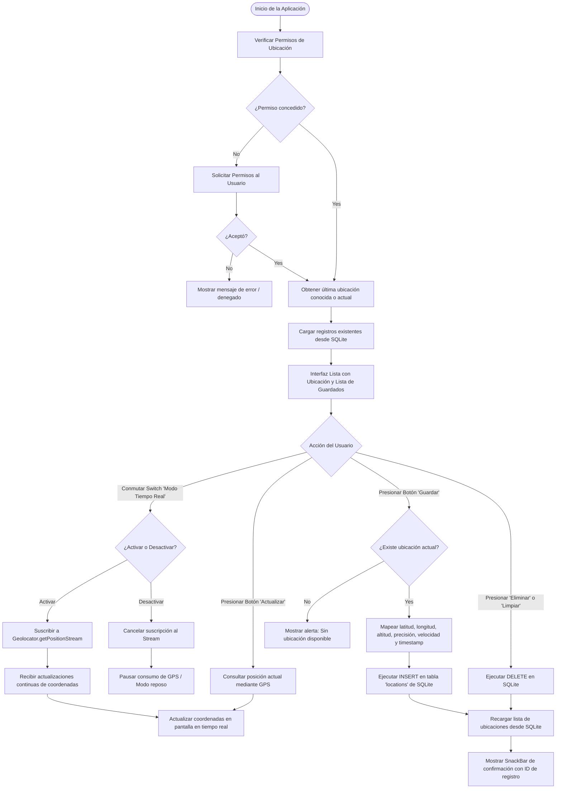
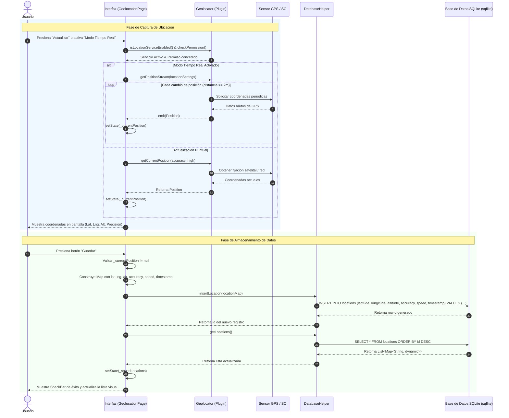

# PoC: Geolocalización y Persistencia de Datos

Este documento describe la interacción y el flujo técnico de la Prueba de Concepto (PoC) para la captura de geolocalización y persistencia en base de datos relacional SQLite mediante los siguientes dos diagramas.

---

## 1. Diagrama de Flujo: Uso e Interacción entre Botones y Controles

---

## 2. Diagrama de Secuencia: Captura y Almacenamiento de Ubicación

